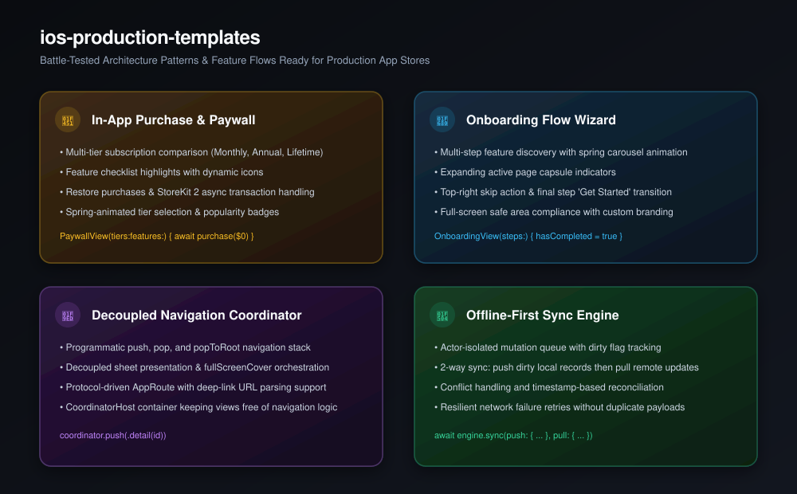

# ios-production-templates

[](https://github.com/nilkanthdesai76/ios-production-templates/actions/workflows/ci.yml)
[](https://swift.org)
[](https://developer.apple.com)
[](LICENSE)

Production-ready architecture blueprints and foundational application flows for iOS and macOS. Drop them straight into your codebase to skip days of boilerplate and build shipping-grade apps faster.

<p align="center">
  
</p>

---

## ⚡ Included Blueprints

| Blueprint | Category | Description | Primary File |
| :--- | :--- | :--- | :--- |
| **Paywall & IAP** | Monetization | Subscription tiers, feature list, restore purchases, spring animations. | [`PaywallView.swift`](Sources/IOSProductionTemplates/Paywall/PaywallView.swift) |
| **Onboarding Wizard** | First-Run UX | Multi-step feature discovery with spring carousel and animated capsule indicators. | [`OnboardingView.swift`](Sources/IOSProductionTemplates/Onboarding/OnboardingView.swift) |
| **Navigation Coordinator** | Architecture | Programmatic router handling push/pop, sheets, and full-screen covers. | [`NavigationCoordinator.swift`](Sources/IOSProductionTemplates/Coordinator/NavigationCoordinator.swift) |
| **Offline-First Sync Engine** | Data & Networking | Actor-isolated mutation queue with dirty tracking and reconciliation. | [`SyncEngine.swift`](Sources/IOSProductionTemplates/Storage/SyncEngine.swift) |

---

## 📦 Installation

Add via Swift Package Manager:

```swift
dependencies: [
    .package(url: "https://github.com/nilkanthdesai76/ios-production-templates.git", from: "1.0.0")
]
```

Or copy-paste any single file directly into your Xcode project (no third-party dependencies).

---

## 🚀 Quick Examples

### 1. In-App Purchase Paywall

```swift
let tiers = [
    PaywallTier(id: "monthly", title: "Monthly", price: "$6.99", period: "/ month"),
    PaywallTier(id: "annual", title: "Annual", price: "$49.99", period: "/ year", badge: "Save 40%", isPopular: true)
]

let features = [
    PaywallFeature(icon: "bolt.fill", title: "Unlimited Exports", subtitle: "Process full-res 4K documents"),
    PaywallFeature(icon: "icloud.fill", title: "Cloud Sync", subtitle: "Instant sync across your Apple devices")
]

PaywallView(
    features: features,
    tiers: tiers,
    selectedTierId: $selectedTier
) { tier in
    await purchaseSubscription(tier)
} onRestore: {
    await restorePurchases()
}
```

### 2. Multi-Step Onboarding Wizard

```swift
let steps = [
    OnboardingStep(id: 0, icon: "wand.and.stars", title: "AI Assistant", description: "Summarize and organize your tasks automatically"),
    OnboardingStep(id: 1, icon: "lock.shield", title: "Private by Default", description: "All data stays on your device with local encryption")
]

OnboardingView(steps: steps) {
    hasCompletedOnboarding = true
}
```

### 3. Programmatic Navigation Coordinator

```swift
enum AppRoute: AppRoute {
    case details(String)
    case settings

    var id: String {
        switch self {
        case .details(let id): return "details_\(id)"
        case .settings: return "settings"
        }
    }
}

@StateObject var coordinator = NavigationCoordinator<AppRoute>()

CoordinatorHost(coordinator: coordinator) {
    HomeView(onSelect: { id in coordinator.push(.details(id)) })
} destination: { route in
    switch route {
    case .details(let id): DetailsView(id: id)
    case .settings: SettingsView()
    }
}
```

---

## 📄 License

This repository is licensed under the [MIT License](LICENSE).
